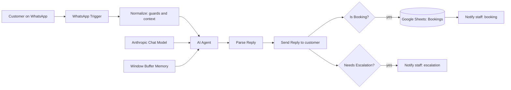

# WhatsApp AI Booking & Enquiry Agent (n8n + Claude)

> An n8n workflow that answers customer enquiries on WhatsApp with an AI agent, captures confirmed booking requests into Google Sheets, alerts staff, and escalates anything it cannot answer to a human.

**Author:** Tito M — AI Automation | AI Agents | Product Design | Data

Built for **Kwara Innovation Lab** (Ilorin, Nigeria), a digital skills and innovation centre operated by Tech2Grassroots Africa.

> **Documentation status:** This documentation is based on the exported n8n workflow (`workflow/whatsapp-agent.sanitized.json`), which was read node by node. The export is marked *inactive* and credentials were unset, so **no production usage, volumes, or results are claimed.** Phone numbers and the contact email in the export were replaced with placeholders.

---

## 1. Overview
A 13-node n8n workflow (including one notes node) that connects the WhatsApp Business Cloud API to an AI agent running on Anthropic Claude. It answers questions about programmes, prices, and how to join, takes booking requests, and hands off to staff when needed.

## 2. Problem Statement
Training centres receive repeated WhatsApp questions about courses, fees, and joining, often outside office hours. Staff time goes to repetitive replies, and booking details get lost in chat threads. This workflow gives instant answers 24/7, records bookings in a spreadsheet, and routes edge cases to people.

## 3. Objectives
- Answer enquiries from approved information only.
- Collect booking requests conversationally and save them reliably.
- Notify staff of bookings and escalations.
- Control cost and abuse with rate limits, dedupe, and human takeover.

## 4. Key Features
- AI agent with a strict, fact-limited system prompt
- Short-term conversation memory per customer (last 12 messages)
- Structured JSON output (`reply`, `booking`, `escalate`) parsed by code
- Booking capture to Google Sheets with a generated reference (`KIL-XXXXX`)
- Staff WhatsApp alerts for bookings and escalations
- Safeguards: webhook dedupe, stale-message guard, 40 messages/hour/customer limit, duplicate booking and escalation suppression
- Staff commands `/bot off` and `/bot on` to pause the bot for one customer (2 hours)
- Fallback reply if the AI output cannot be parsed

## 5. Architecture

More: [`docs/architecture.md`](docs/architecture.md)

## 6. Workflow
Message in → guards → AI → parse → reply → (booking save + staff alert) and/or (escalation alert). See [`docs/workflow.md`](docs/workflow.md).

## 7. Technology Stack
n8n · WhatsApp Business Cloud API (Meta) · Anthropic Claude (`claude-sonnet-4-5`, max 700 tokens) · Google Sheets · JavaScript (n8n Code nodes)

## 8. Integrations
See [`docs/integrations.md`](docs/integrations.md).

## 9. Setup
See [`docs/configuration.md`](docs/configuration.md). Import `workflow/whatsapp-agent.sanitized.json`, attach your own credentials, set the staff number, and connect the webhook.

## 10. Security
See [`docs/security.md`](docs/security.md).

## 11. Limitations & Roadmap
See [`docs/limitations-and-roadmap.md`](docs/limitations-and-roadmap.md).

## 12. Author
**Tito M** — AI Automation | AI Agents | Product Design | Data
